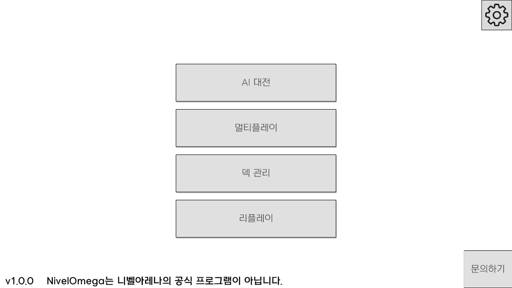
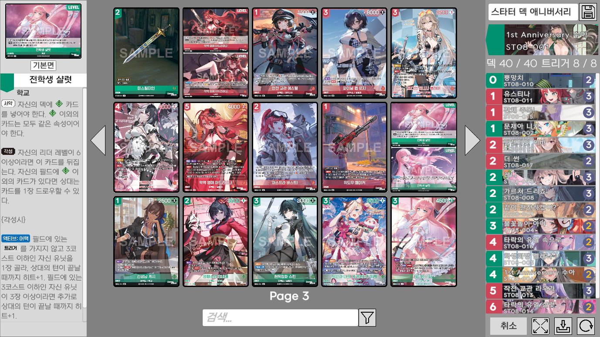
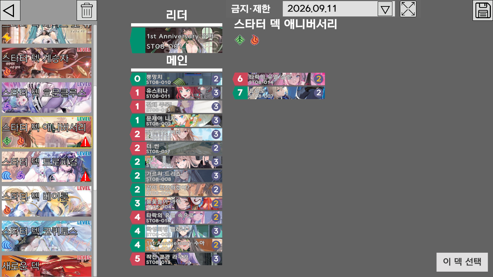
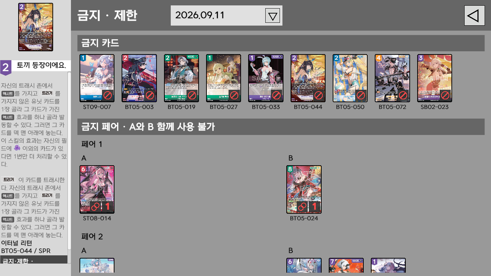
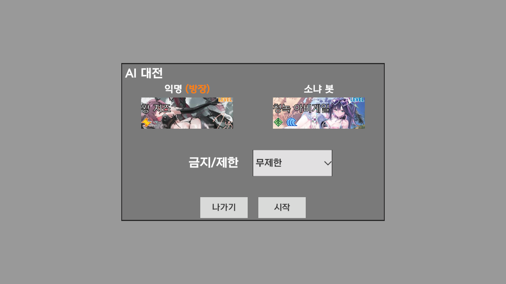
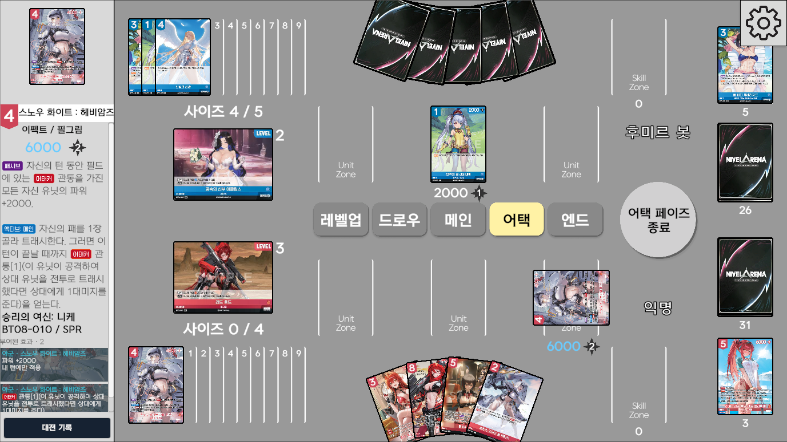
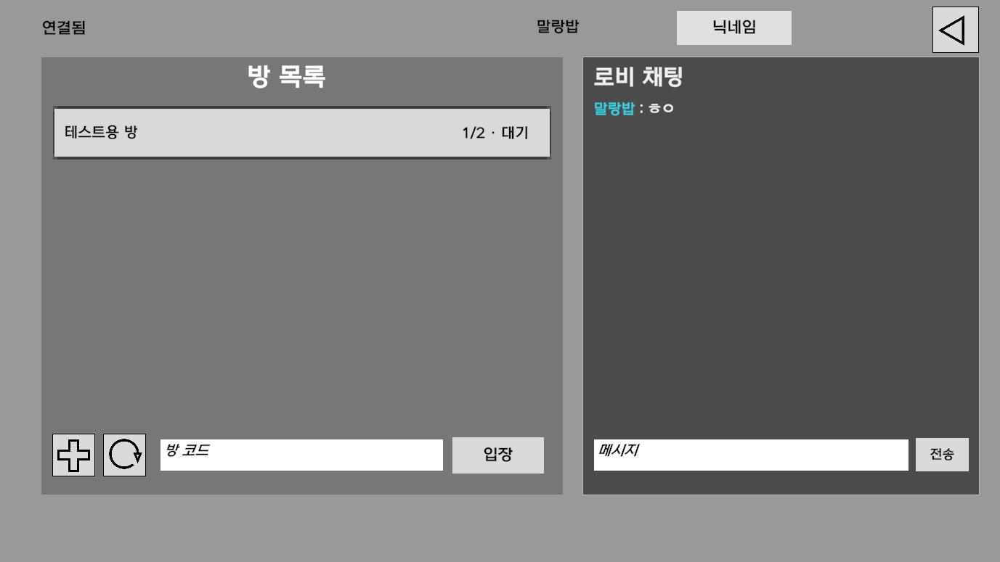
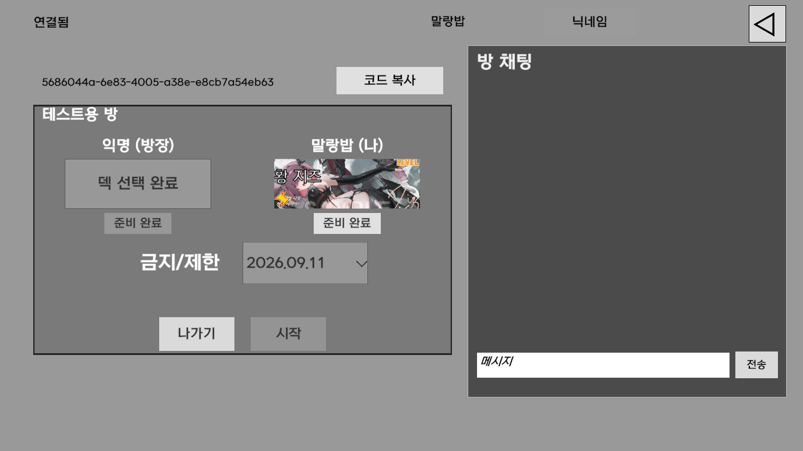
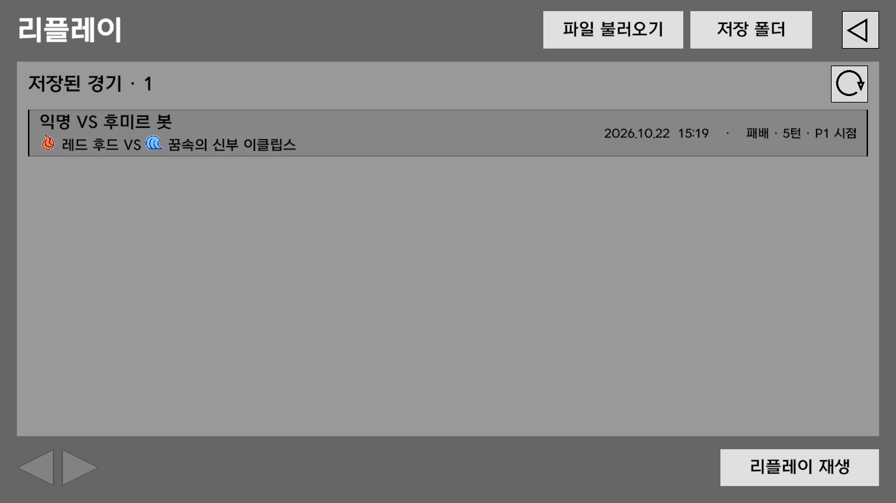
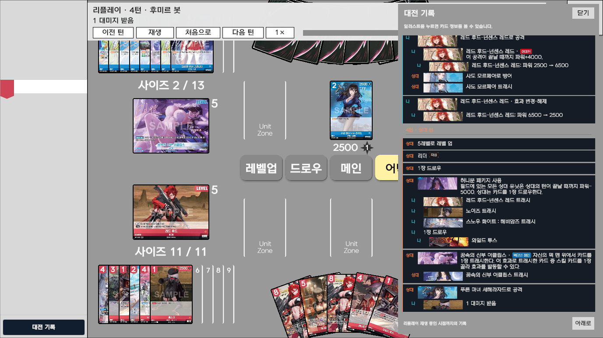

# NivelOmega
NivelOmega 니벨오메가는 젬블로컴퍼니의 TCG게임 '니벨아레나 NivelArena'의 비공식 온라인 시뮬레이터입니다.

# 주요 기능
## 덱 관리
덱을 수정하여 그리드 이미지/리스트 이미지/텍스트/제출 시트로 내보낼 수 있습니다.

그리드 이미지/텍스트로 덱을 불러올 수 있습니다.

금지/제한 목록도 확인 가능합니다.

---
## AI 대전

---
## 멀티플레이
방을 생성하여 단판 경기를 진행할 수 있습니다.

방의 금지/제한을 설정하여 대전할 수 있습니다. (무제한도 지원합니다.)

로비 채팅/방 채팅도 지원합니다.

---
## 리플레이
리플레이는 파일로 저장되며 파일을 공유하여 공유할 수 있습니다.

듀얼로그도 지원합니다.
